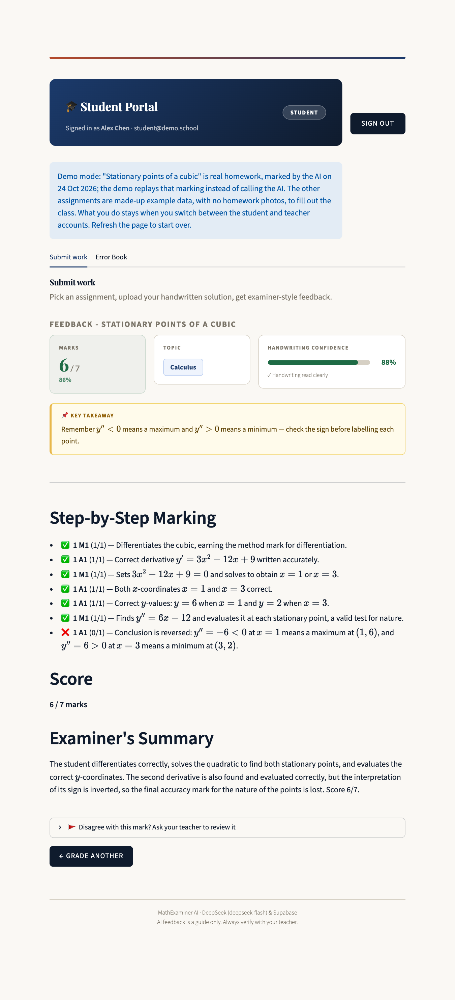
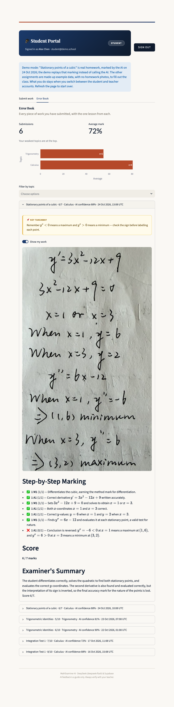
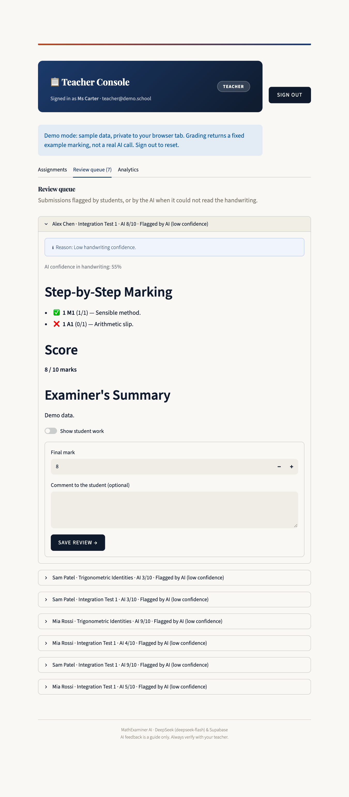
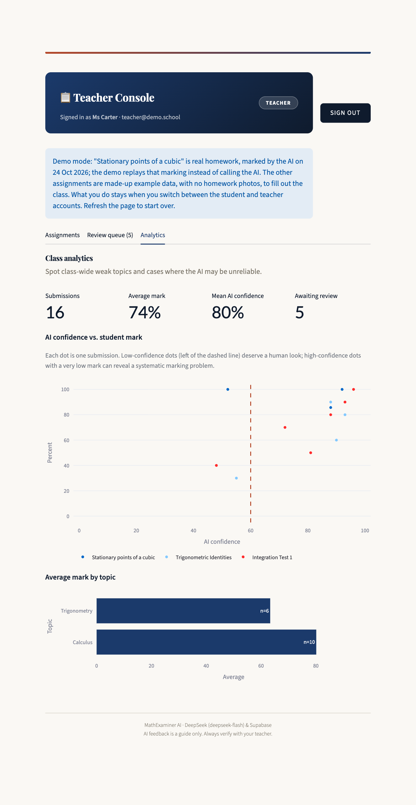
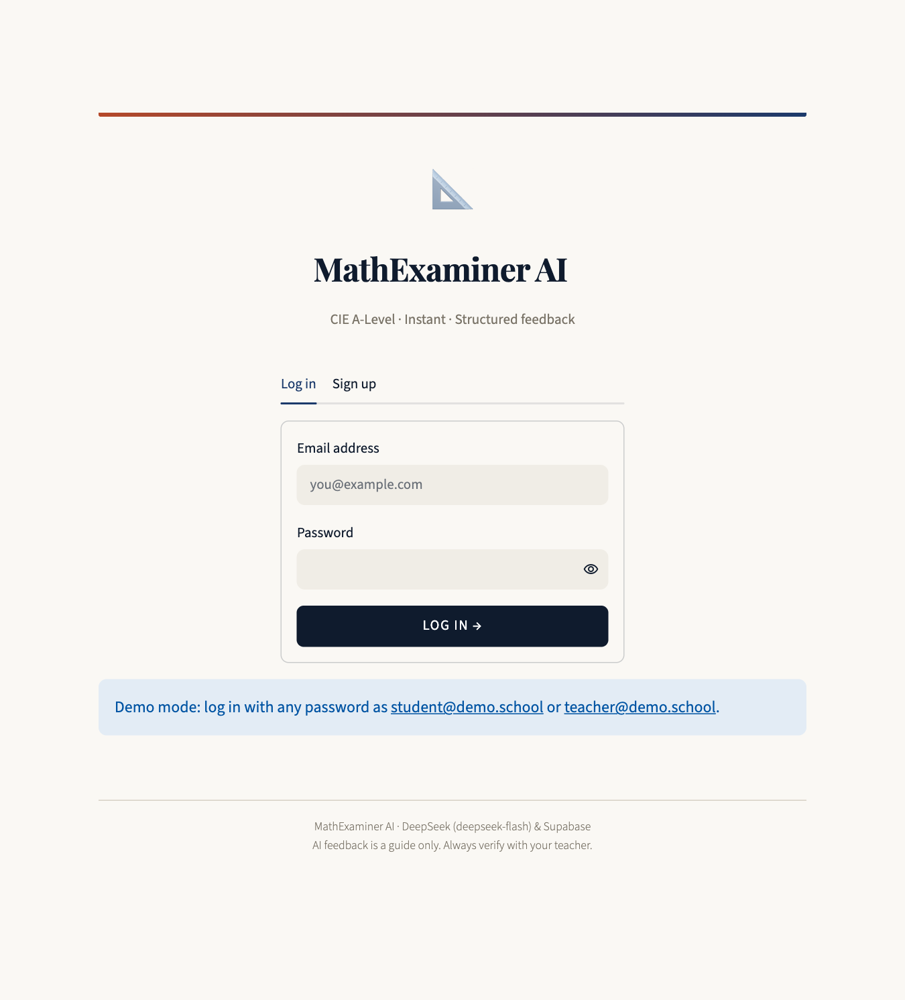
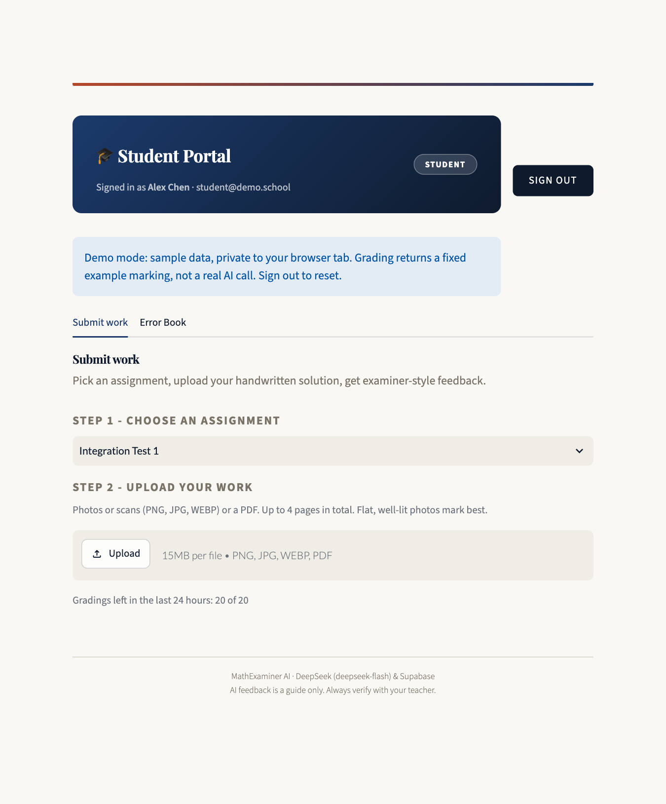
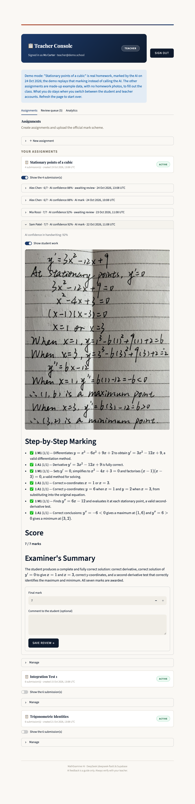
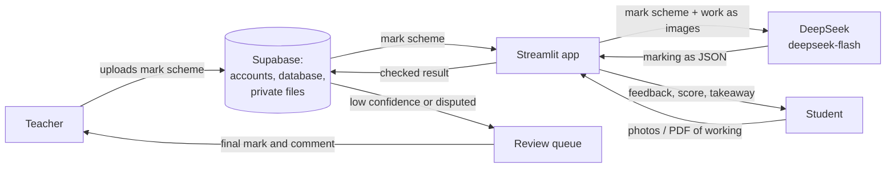

# MathExaminer AI

[](https://github.com/WHYNOT-LUO/mathexaminer-ai/actions/workflows/ci.yml)


[](https://mathexaminer-ai-demo.streamlit.app)

**AI marking of handwritten CIE A-Level Mathematics, the way an examiner marks it, with a teacher in
control.**

Students photograph their handwritten working. The app marks it step by step against the official
Cambridge mark scheme, giving method (M), accuracy (A) and independent (B) marks with a reason for
each, so a student who uses the right method but slips on the arithmetic still earns the method mark.
When the AI is not sure it read the handwriting, or a student disagrees with a mark, the work goes to
a teacher, who makes the final call.

> **Try it now: [mathexaminer-ai-demo.streamlit.app](https://mathexaminer-ai-demo.streamlit.app)**
> Log in as `student@demo.school` or `teacher@demo.school` with any password. No sign-up or keys
> needed. The homework in the demo is real: a question, its mark scheme and three handwritten answers,
> each graded once by the real AI. The demo replays those recorded markings instead of calling the AI.
> Try a sample answer as the student, dispute the mark, then sign in as the teacher to review it.
> The "Hard to read" answer is a blurry photo the AI could not read confidently, so it goes to the
> teacher's review queue on its own.

## Contents

- [Why I built it](#why-i-built-it)
- [Screenshots](#screenshots)
- [Features](#features)
- [How it works](#how-it-works)
- [Run it yourself](#run-it-yourself)
- [Configuration](#configuration)
- [Testing](#testing)
- [Project layout](#project-layout)
- [Security and privacy](#security-and-privacy)
- [Known limitations](#known-limitations)
- [Troubleshooting](#troubleshooting)
- [Project history](#project-history)
- [Roadmap](#roadmap)
- [License](#license)

Technical details (the grading pipeline, data model and access rules) are in
[docs/architecture.md](docs/architecture.md).

## Why I built it

Marking handwritten maths takes teachers a lot of time, and students wait for their feedback. I
wanted a tool that gives the kind of feedback an examiner gives, mark by mark, within a minute of
submitting.

The harder question was trust. An AI that marks confidently but wrongly is worse than no tool at all.
So the project is built around keeping a teacher in control: the AI reports how sure it is that it
read the handwriting, unclear work goes straight to the teacher, students can dispute any mark, and
the teacher's decision always overrides the AI's.

## Screenshots

| Student: mark-by-mark feedback | Student: Error Book |
|---|---|
|  |  |
| **Teacher: review queue** | **Teacher: analytics** |
|  |  |

<details><summary>More: login, the question and sample answers, a teacher's view of every submission</summary>





</details>

*Screenshots are from the built-in demo. The handwriting and its marking are real (recorded from the AI);
the student names are made up.*

## Features

### For students

- **See the question** the teacher attached, then **submit work** as photos or a PDF: up to 4 pages, any mix of files. Phone photos are straightened automatically.
- **Mark-by-mark feedback** in Cambridge style (M1, A1, B1, ...), each mark with a short reason and maths written properly.
- **A score, a topic and one key takeaway:** the single mistake not to repeat, or one habit worth keeping.
- **Handwriting confidence:** how sure the AI is that it read the writing correctly.
- **Dispute a mark** with a reason; the work goes to the teacher.
- **Error Book:** every past submission with the student's own pages, the takeaway and any teacher correction, filterable by topic, with a chart of the weakest topics.

### For teachers

- **Assignments:** create one by uploading the official mark scheme (image or PDF, up to 6 pages) and, optionally, the question sheet students will see. Close it to stop new submissions, replace the mark scheme, or delete it.
- **Every submission:** for each assignment, open any student's handwritten pages next to the AI's marking, and set a final mark.
- **Review queue:** work arrives here automatically when the AI's handwriting confidence is below 60%, and whenever a student disputes a mark. Teachers can open the student's original pages alongside the AI's marking, set the final mark and leave a comment.
- **Class analytics:** submission count, average mark, average AI confidence and work awaiting review; a chart of AI confidence against students' marks, to show which gradings deserve a second look; and the average mark by topic.

### Under the hood

- **The program does the arithmetic.** The AI returns one entry per mark; the app checks each entry and adds up the total itself.
- **Access is enforced by the database**, through row-level security, not just hidden in the interface.
- **Costs are capped:** each student has a grading allowance per 24 hours, and every grading has a time limit.
- **104 automated tests** run on every push, on Python 3.10 and 3.12.

### Measured speed and cost

Grading the three real sample answers with `deepseek-flash` (October 2026):

| Answer | Score | Handwriting confidence | Tokens in / out | Time | Cost at DeepSeek's listed prices |
|---|---|---|---|---|---|
| Strong | 7/7 | 92% | 2,544 / 656 | 12 s | $0.0008–$0.0016 |
| Typical mistake (maximum and minimum swapped) | 6/7 | 88% | 2,034 / 718 | 8 s | $0.0005–$0.0011 |
| Hard to read (full-resolution photo) | 7/7 | 85% | 2,052 / 1,526 | 12 s | $0.0010–$0.0020 |
| Hard to read (low-resolution copy, used in the demo) | 7/7 | 52% (sent to the teacher) | 1,787 / 2,518 | 14 s | $0.0016–$0.0031 |

That is about 0.05 to 0.3 US cents per grading; the range is DeepSeek's off-peak and peak prices.
The AI read my messy handwriting with 85% confidence, above the 60% line. To show what happens when it
cannot read the work, the demo uses a low-resolution copy of the same photo: the AI still gave the right
marks but reported only 52% confidence, so the app sent the work to the teacher to check.
The marking replies themselves are in [`demo/samples/recorded-gradings.json`](demo/samples/recorded-gradings.json).

## How it works



1. **Prepare the images.** The student's pages are converted to compact JPEGs (longest side 1600 px). PDFs are rendered page by page.
2. **Mark.** The app sends DeepSeek the marking instructions, the mark scheme pages and the student's pages, and asks for a JSON answer.
3. **Check.** The answer is validated: marks are clamped to what the scheme allows, unknown topics become "Other", and the total is computed in code. An unusable answer gets one retry.
4. **Save and route.** The result is saved by the server. If handwriting confidence is below 60%, it is flagged for the teacher in the same step.

The full step-by-step flow, including every limit and time-out, is in
[docs/architecture.md](docs/architecture.md#how-one-grading-flows).

## Run it yourself

You need Python 3.10 or newer.

### Option A: the demo (no accounts or keys)

```bash
git clone https://github.com/WHYNOT-LUO/mathexaminer-ai.git && cd mathexaminer-ai
python3 -m pip install -r requirements.txt
python3 -m streamlit run demo/demo_app.py
```

Log in as `student@demo.school` or `teacher@demo.school` with any password.

### Option B: the real app

**1. Supabase** (accounts, database and file storage)

1. Create a project at [supabase.com](https://supabase.com).
2. Open the **SQL Editor**, paste all of [`supabase/schema.sql`](supabase/schema.sql) and run it. It creates the tables, the access rules, the private storage buckets and the sign-up trigger. It is safe to run again.
3. Create a teacher access code. Teachers enter it when they sign up; students leave it blank. Use a long random string, not this example:
   ```sql
   insert into public.teacher_codes (code, note) values ('choose-a-long-random-string', 'staff room');
   ```
4. *(Optional, for testing)* Under **Authentication → Providers → Email**, turn off "Confirm email" so new accounts can log in straight away.
5. From **Project Settings → API**, copy the **Project URL**, the **anon (publishable)** key and the **service_role** key. The service_role key bypasses all access rules, so keep it on the server only: in `.streamlit/secrets.toml` (which git ignores) or your host's secrets settings.

**2. DeepSeek** (the AI)

Create an API key at [platform.deepseek.com](https://platform.deepseek.com/) and add some credit. The
default model, `deepseek-flash`, is DeepSeek's model that can read images; `deepseek-v4-pro` is
text-only and cannot grade handwriting.

**3. Run**

```bash
python3 -m venv .venv && source .venv/bin/activate
pip install -r requirements.txt
cp .streamlit/secrets.toml.example .streamlit/secrets.toml   # then fill in your values
streamlit run app.py
```

### Deploying

On [Streamlit Community Cloud](https://streamlit.io/cloud), point a new app at this repository:

- **The public demo:** use `demo/demo_app.py` as the main file. It needs no secrets.
- **The real app:** use `app.py` and paste the same keys into the app's **Secrets** settings.

## Configuration

Set these in `.streamlit/secrets.toml` or as environment variables.

| Key | Required | Default | Purpose |
|---|---|---|---|
| `SUPABASE_URL` | yes | | Supabase project URL |
| `SUPABASE_KEY` | yes | | anon (publishable) key, used with each user's login |
| `SUPABASE_SERVICE_KEY` | yes | | service_role key, server only: saving grades, the allowance, downloading mark schemes. Must differ from the anon key. |
| `DEEPSEEK_API_KEY` | yes | | DeepSeek API key |
| `DEEPSEEK_MODEL` | no | `deepseek-flash` | Must be a DeepSeek model that accepts images |
| `DEEPSEEK_BASE_URL` | no | `https://api.deepseek.com` | A relay, if DeepSeek is not reachable directly; see [`docs/cloudflare-worker.js`](docs/cloudflare-worker.js) |
| `MAX_GRADINGS_PER_DAY` | no | `20` | Gradings per student per 24 hours |

## Testing

```bash
pip install -r requirements-dev.txt
pytest       # 104 tests
ruff check .
```

| Test file | Tests | What it covers |
|---|---|---|
| `test_models.py` | 19 | Totals computed from the marks, clamping, unknown topics, bad numbers from the AI |
| `test_deepseek.py` | 25 | The request sent to DeepSeek, the retry at low effort, time limits, friendly error messages that never contain the API key |
| `test_app.py` | 27 | The real interface driven with Streamlit's `AppTest`: log in, grading a sample answer (including the low-confidence one going to the teacher), the question sheet, the Error Book, dispute, teacher review and the submissions list, deleting an assignment, attempts to inject HTML, demo isolation; and that every demo marking adds up to its score |
| `test_images.py` | 16 | Rotation, transparency, PDFs, page and size limits, oversized "decompression bomb" images |
| `test_db.py` | 11 | The grading allowance, server-side saving with flags, closed assignments, question sheets, file clean-up |
| `test_config.py` | 6 | Missing or invalid settings, and the service key not being the anon key |

The AI and the database are replaced by fakes in the tests, so they need no keys and cost nothing. A
contract test checks that the demo backend has exactly the same functions as the real data layer.

GitHub Actions runs `ruff` and `pytest` on every push ([`ci.yml`](.github/workflows/ci.yml)). A second
workflow ([`keep-demo-awake.yml`](.github/workflows/keep-demo-awake.yml)) visits the hosted demo every
6 hours so Streamlit Community Cloud does not put it to sleep.

## Project layout

```
app.py                     Entry point: settings check, per-session Supabase clients, student/teacher routing
mathexaminer/
  config.py                Settings from secrets or environment variables, validated
  images.py                Photos and PDFs -> JPEG pages (rotation, transparency, size and page limits)
  deepseek.py              The grader: prompt, DeepSeek request, retry and time limits, safe error messages
  models.py                GradingResult: checks the AI's answer and computes the totals
  db.py                    Supabase: sign-in, tables, file storage; user client vs server-only service client
  ui/                      Streamlit pages: sign-in, student, teacher, analytics, shared components, styles
supabase/schema.sql        Tables, row-level security, storage rules and database functions
demo/                      In-memory backend, so the interface runs with no accounts or keys
  samples/                 The real question, mark scheme, three handwritten answers and their recorded markings
tests/                     pytest suite
docs/                      Architecture notes, screenshots, the optional Cloudflare relay, the original design sketch
.github/                   CI and the keep-the-demo-awake workflow
```

## Security and privacy

- **The database enforces access.** Every table uses row-level security. Students see only their own work; teachers see submissions for their own assignments.
- **Roles cannot be self-assigned.** An account becomes a teacher only if it signs up with a valid teacher code, checked inside the database.
- **Scores come only from the grader.** Students have no permission to create or edit submissions. The server saves each result, and a teacher's override is the only way a mark changes.
- **Students cannot download mark schemes.** The server fetches them to grade.
- **Files are private.** Mark schemes, question sheets and student work are in private storage, never publicly linked. A teacher can open a student's work only if it was submitted to one of that teacher's assignments, and students can open only the question sheets of open assignments.
- **Secrets stay on the server.** Streamlit runs the Python on the server; keys never reach the browser, and error messages never include them.
- **Uploaded images are treated as untrusted.** The AI is told to ignore instructions written inside them, and every piece of text shown on screen is escaped.

The full access table is in [docs/architecture.md](docs/architecture.md#access-control).

## Known limitations

- **AI marking can be wrong.** Handwriting confidence is the AI's own estimate of how well it read the writing, not proof the marking is right. That is why the review queue exists, and why the analytics show where to double-check.
- **The 60% review threshold is a starting point**, not a measured value. Comparing the AI's marks with teachers' final marks would show where it should be.
- **No classes yet.** Every student sees every open assignment, and every teacher can see the list of all users' names.
- **No deadlines or notifications.** Teachers check the review queue themselves.
- **A question sheet can only be added when an assignment is created**, not replaced later.
- **The feedback reveals the mark scheme's approach** once work is submitted, so this is for practice and homework, not unseen exams.
- **Signing in lasts for one browser tab.** Refreshing the page signs you out.
- **Supabase's free tier pauses** a project after 7 days without activity. The real app stops working until it is restored from the Supabase dashboard; the demo is unaffected.

## Troubleshooting

| Message or symptom | What to do |
|---|---|
| "MathExaminer AI is not configured yet. Missing configuration: …" | Copy `.streamlit/secrets.toml.example` to `.streamlit/secrets.toml` and fill in the keys it lists. |
| "SUPABASE_SERVICE_KEY must be the service_role key …" | You pasted the anon key twice. Copy the service_role key from Project Settings → API. |
| "Signed in, but your profile was not found. Was supabase/schema.sql applied?" | Run `supabase/schema.sql` in the SQL Editor, then create a new account. Profiles are made by a sign-up trigger, so accounts created before the schema was applied have none. |
| "Please confirm your email address before logging in." | Click the link in the confirmation email, or turn off "Confirm email" in Supabase. |
| "The AI service rejected the API key." | Check `DEEPSEEK_API_KEY`. |
| "The AI service is rate-limited or the account is out of balance." | Wait a minute, or add credit on platform.deepseek.com. |
| "AI model '…' was not found." | Set `DEEPSEEK_MODEL` to a current DeepSeek model that accepts images. |
| "The AI ran out of space while reasoning and returned no marking." | The AI used its whole output budget on reasoning, even on the low-effort retry. Try again, or submit fewer pages at a time. |
| "You have used all 20 gradings for the last 24 hours." | Wait, or raise `MAX_GRADINGS_PER_DAY`. |
| The real app cannot load anything | The Supabase project may be paused. Restore it from the Supabase dashboard. |
| The demo shows "Yes, get this app back up!" | Click it and wait about 30 seconds while it starts. |
| The demo says it "only marks the three sample answers" | The demo replays recorded markings, so it cannot mark new work. Use a sample answer, or run the real app. |

## Project history

1. **Version 1 (design).** A single upload page with no accounts: upload a mark scheme and a student's work, read the AI's report.
2. **Version 2.** Accounts for teachers and students, a database, assignments and flagging, over many iterations. It first used Anthropic's Claude, then Google's Gemini, and asked the AI for a written report whose score was pulled out of the text.
3. **Rebuild (September 2026).** An audit found the Gemini model the app depended on had been retired, so grading no longer worked, and there were security gaps. I rebuilt it with JSON marking checked in code, database-enforced access, the review queue, analytics, the Error Book, automated tests and a public demo, and moved the AI to DeepSeek.
4. **Real-world test.** Grading my own handwritten working end to end showed that a hard script could use the AI's whole output budget on reasoning and return no marks. I raised the budget and added the retry at low reasoning effort.
5. **Code review.** Grades were moved to server-side writes, the allowance was made to count every attempt, and time limits were added to each grading.
6. **Real demo (October 2026).** The public demo was rebuilt around a real question, my own mark scheme and three of my handwritten answers, each graded once by the real AI. At the same time I added question sheets for students and a submissions list for teachers, and limited each teacher to their own students' work.

I designed the product (what it marks, how teacher review works, what students get back) and
tested it with real handwriting. Much of the code was written with AI coding assistants.

## Roadmap

- Classes and enrolment, so students see only their own class's assignments and teachers only their own students.
- Deadlines and email notifications for flagged work.
- A measured accuracy check: compare the AI's marks with teachers' final marks, and use the result to set the review threshold.
- An error catalogue: record which known mistake caused each lost mark, so teachers can see which misunderstandings come up most.

## License

[MIT](LICENSE) © 2026 Muen Luo
